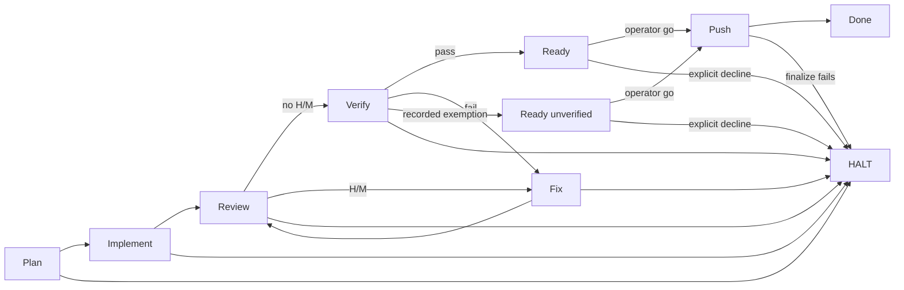

# Workflow loop (2026-10-24)

Status: active, superseded in part on 2026-11-03. This record designed the
six-phase loop; Wave 13 added the `PlanReview` phase and the progress-bounded
plan-review gate (`plan-review-gate-2026-11.md`), so the phase list and the
one-refinement bound described below are historical. The transition-guard
reasoning still holds.

Original scope: replaces the linear reading of the six-phase doctrine with an
explicit loop. The phases were `Plan, Implement, Review, Fix, Verify, Push` so
the role `owned_phases` schema and the existing templates remained stable.
Aliases: **Research is inside Plan**, **Review is the audit gate**, **Push is
the finalize gate**; **Plan review is the spec gate** was added with Wave 13.

## Why a loop, not a list

A linear list has no state, no transition guards, and no termination rule. In a
multi-agent system that produces the common failure modes MAST catalogues:
handoffs without evidence, review findings that never re-enter review, and
verification failures that become "done" anyway (S9). The loop makes the two
back-edges explicit:



More precisely, `Ready`, `Ready (unverified)`, `Done`, and `HALT` are outcomes, not phases. `Push` is
operator-gated; without an explicit `go` the agent stops at `Ready`.

## States and transitions

| From | Guard | To | Required artifact / evidence |
|---|---|---|---|
| Plan | Spec is decision-complete: goal, units, acceptance, verification commands, research sources and dates | Implement | Spec in the ledger; unknowns are explicit |
| Plan | Blocker, unsafe request, or ambiguity that one refinement cannot resolve | HALT | HALT reason and the exact missing decision |
| Implement | One writer per shared surface; diff complete; notes captured | Review | Diff, changed-file list, verification notes |
| Implement | Blocked, unsafe, or out of scope | HALT | HALT reason and the changed paths |
| Review | No open high or medium finding | Verify | Review report with severity and evidence |
| Review | High or medium finding | Fix | Finding list, each with evidence and acceptance impact |
| Review | Unresolvable conflict or missing authority | HALT | Conflict record and the missing authority |
| Fix | Patch addresses each finding; spec still valid | Review | Patch plus a response to every finding |
| Fix | The spec itself is wrong, not the code; first return only | Plan | Spec-gap record |
| Fix | A second spec-gap return | HALT | Refinement record and unresolved decision |
| Fix | Same gate still blocked after one refinement | HALT | Refinement record and unresolved decision |
| Verify | Fresh output, exit code, and artifact prove every criterion | Ready | Evidence bundle from this run |
| Verify | A recorded exemption covers the missing check; claim marked unverified | Ready (unverified) | Exemption record and operator decision |
| Ready (unverified) | Explicit operator `go` | Push | Operator approval |
| Ready (unverified) | Explicit operator decline | HALT | Recorded decline |
| Verify | Any criterion fails, and repair is in scope and safe | Fix | Failing command, output, exit code |
| Verify | Proof cannot run, is unsafe, or is out of scope | HALT | Missing proof and the scope reason |
| Ready | Explicit operator `go` | Push | Operator approval |
| Ready | Operator declines | HALT | Recorded decline |
| Push | Commit/push/handoff succeeds | Done | Commit/push/deploy result, harness, model, closeout |
| Push | Finalize action fails | HALT | Failure output and rollback note |

## Loop levels

1. **Research loop (inside Plan).** Gather until the spec is decidable. Stop on
   decision-completeness, not on "enough reading".
2. **Audit loop (Review -> Fix -> Review).** Every high/medium finding re-enters
   review. Re-audit the changed lines and the risk they touch.
3. **Proof loop (Verify -> Fix -> Review -> Verify).** A failed proof is a
   repair that must pass the same proof. Code changes during Fix re-enter
   Review before Verify.
4. **Unit loop (orchestrator).** A new unit starts at Plan. The orchestrator
   owns the ledger and routes units; a subagent never starts a second unit.

## Loop bounds and termination

- One refinement per gate, then escalate. Do not run unbounded fix loops.
- A pass requires evidence; silence or a summary is not a pass.
- HALT is a valid terminal outcome: blocked, unsafe, ambiguous, or over the
  refinement bound.
- A `Verify` failure after a `Fix` always re-enters `Review` if code changed.
- A `Review` pass with an unverified claim is not a pass; mark it unverified and
  route to Verify or HALT.

## Ledger

The orchestrator keeps one durable row per unit:

```text
unit_id | phase | attempt | gate | status | artifact | findings | evidence | decision | owner | timestamp | next
```

- `attempt`: the refinement attempt at the current gate, 0 or 1. The row is a
  snapshot; earlier gate attempts are in the commit history.
- `gate`: `pass | fix | hold | halt`.
- `findings`: id, severity, evidence, acceptance impact, owner.
- `evidence`: command, exit code, timestamp, scope, harness, model.
- `decision`: pass, fix, hold, halt.
- Resume from the ledger, not from chat memory. Store it in the active
  `PLAN.md` wave or `provenance/ledger-<task>.md`.

## Concurrency and context

- One writer per shared file, module, or decision space. Parallelize reads,
  searches, and independent reviews only.
- The Review/Verify agent gets the artifact, acceptance criteria, and evidence
  commands; it does not get the author's reasoning or conclusion.
- The author is never the only verifier.
- Keep the always-loaded context small; put procedures in skills and depth in
  referenced files.

## Prompt implementation

| Surface | Change |
|---|---|
| `fragments/agent-doctrine.md` | Carries the loop, the two back-edges, the one-refinement bound, and the aliases |
| `agents/**` and `prompts/tasks/**` | Doctrine block replaced byte-for-byte; phase maps remain role-specific |
| `agents/orchestration/orch-orchestrator.md` | Owns the loop and ledger; routes Fix -> Review and Verify -> Fix -> Review -> Verify |
| `standards/subagent-delegation.md` | Handoff names its phase and gate; Review/Verify returns findings or evidence, never a new task |
| `commands/orchestrate.md` | Names the loop and the two back-edges |
| `standards/agent-prompt-standard.md` AP-14 | Defines the loop, aliases, and fragment identity |

## Why this is the evidence-backed shape

- (`likely`, secondary summaries) Centralized coordination with verification contains error amplification
  (4.4x centralized vs 17.2x independent across 260 configurations; 22.7%
  average error reduction with verification).
- (`likely`) Verification is the highest-leverage gate: MAST reports +15.6% from an added
  verification step; clean-context review caught about 2 bugs per PR, 58%
  severe.
- Simple pipelines can beat complex agents on bounded coding; do not add phases
  or agents without a measured need (Agentless).
- (`likely`) Multi-agent gains are task-dependent: +80.8% on decomposable work to -70.0%
  on sequential planning; subagents buy breadth and context isolation, not
  general intelligence.
- Intrinsic self-correction is unreliable; external feedback and independent
  verification are the supported mechanisms.
- Workflow design is empirical; AFlow/GEPA show that workflow and prompt
  changes must be measured, not assumed.

## Verification metrics

Track on every role or workflow A/B:

- gate pass rate and escaped defects;
- rework cycles per unit (target: at most one per gate);
- evidence completeness (command + exit code + artifact);
- handoff failures (missing objective, output contract, or boundaries);
- token cost and wall-clock;
- cache hit rate and model/harness/seed metadata.

## Evidence

Existing register `standards/evidence/prompt-research-2026-10.md` (S6-S26) plus
live checks: MAST (arXiv 2503.13657), "Towards a Science of Scaling Agent
Systems" (arXiv 2512.08296), Agentless (arXiv 2407.01489), "LLMs Cannot
Self-Correct Reasoning Yet" (ICLR 2024), VERIMAP (EACL 2026), AFlow (ICLR 2025).
Most are preprints or vendor evaluations; treat them as design constraints, not
proof. The local A/B is the only proof for this library, and it measured the pre-1.3.1
body; the current body is not A/B'd.

## Validation (2026-10-24, corrected)

The first exploratory A/B is withdrawn: it used an undisclosed favorable rerun,
overcame a valid loss, included a truncated candidate run, and the old arm was
not pinned. The corrected run uses a pinned linear-v1.1 arm, 16,384 tokens for
both arms, and records prompt hashes and budgets in
`evals/role-ab/results/workflow-loop-2026-10.json`. The A-arm body was an
uncommitted working tree and is not exactly recoverable; treat the hashes as
identifiers, not a reproducibility proof.

- 12 role tasks, 3 seeds, 72 raw arm-runs / 35 complete pairs; `ops-format-normalizer` excluded
  because its task requires a tool-enabled harness (text-only 0.33/0.33; tool-enabled 1.0/1.0), so the text-only A/B is not comparable.
- **New loop 0.9525 vs old linear 0.9431; delta +0.0094 (35 complete pairs).**
- **5 wins / 26 ties / 4 losses (one truncated pair excluded).**
- Losses: `eng-api-developer` seed 11, `eng-frontend-developer` seed 11,
  `rev-review-lead` seeds 7 and 23. They are single-task expectation misses,
  not observed transition failures.
- No empty responses at 16,384; one `net-network-architect` seed-11 pair hit the cap and is excluded as truncated.

This is a **neutral** result, not a proven improvement. It was not
pre-registered, and it predates the 1.3.0 state-machine/Push-gate fix; rerun
before treating it as final proof. The
loop is retained for gate correctness, explicit state, and testability, not
because it beat the linear doctrine on this sample. A larger multi-model
holdout is still required.


## Pre-registered confirmation (doctrine 1.3.0)

The earlier exploratory run is superseded for the go/no-go decision by the
pre-registered protocol in
`evals/role-ab/pre-registrations/workflow-loop-1.3.0.md`.

- 12 roles, seeds 211/223/227, 16,384 tokens both arms, pinned linear-v1.1 arm.
- **Current 0.9907 vs candidate 0.9723; delta +0.0184.**
- **3 wins / 32 ties / 1 loss; 35/36 vs 33/36 full passes.**
- No truncated pairs; completion tokens 145,720 current vs 151,763 candidate.
- The one loss is `ops-executor` seed 227, a single expectation miss
  ("names a config or health verification command"), not a transition failure.

This meets the registered non-inferiority bar (+0.0184, above the -0.05 margin)
and is directionally positive. It remains a single-model, single-task-per-role
sample; it is evidence for retaining the loop, not proof of general superiority.
Manifest: `evals/role-ab/results/workflow-loop-1.3.0.json`.

## ops-executor follow-up (2.0.0)

The sole loss in the pre-registered 1.3.0 run was `ops-executor` seed 227,
missing "Names a config or health verification command". The role now carries `rollback` in PROPOSE/FINAL_REPORT and names
`docker compose config -q` plus the affected healthcheck for stack changes. A **post-hoc** targeted check on seeds 211/223/227 is 1.00/1.00
(3 ties, 0 losses); the registered 1.3.0 aggregate still carries the loss, so
this is not a new estimate; the body was fixed at `36a1462` and measured at
`0dd161a`
(`evals/role-ab/results/ops-executor-2.0.0.json`). The legacy layout shims were
also removed in 2.0.0.

## Pre-registered 2.0.0 run on OpenCode Go

The DeepSeek 2.0.0 run was blocked by provider balance at 52/72 arm-runs. After
the model/provider change, a new pre-registered protocol was run on OpenCode Go
(`deepseek-v4.1-flash` executor, `deepseek-v4-pro` grader), seeds 501/509/519,
16,384 tokens. The cache resets on a model change, so the run is not comparable
to the DeepSeek 1.3.0 result.

- 12 roles, 36 pairs, 72 arm-runs; no empty responses.
- 36-pair primary: **0.9907 vs 0.9816**, delta +0.0092, 2 wins / 33 ties / 1 loss.
- 35-pair complete aggregate (one truncated pair excluded): **0.9905 vs 0.9810**,
  delta +0.0094, 2/32/1. The truncated pair is `net-network-architect` seed 519.
- Current-arm loss: `eng-test-author` seed 501 (0.667 vs 1.0).
- Candidate-arm losses: `eng-test-author` seed 509 (1.0 vs 0.667) and
  `rev-review-lead` seed 519 (1.0 vs 0.67); the manifest discloses them.
- `ops-executor` is **1.00/1.00 on all three seeds** in the registered aggregate,
  including the previously failing config/health expectation.
- Manifest: `evals/role-ab/results/workflow-loop-2.0.0-opencode.json`. Raw
results are local (gitignored); the manifest is the durable evidence.

The standalone `ops-executor-2.0.0.json` check remains post-hoc; this full
registered aggregate measured the pre-1.3.1 body; it is historical, not evidence
for the current body. The 1.3.0 DeepSeek result remains historical and still
carries its original loss.

## Long-horizon extension (2026-10-25)

The loop above is a **unit** contract. `standards/long-horizon-runs.md`
(LH-01..LH-14) adds a **run** layer above it: durable run state, checkpoints,
cold-start resume, incremental delivery, context compaction, progress and stall
detection, goal integrity, budgets and termination, a run-scope acceptance gate,
operator monitoring, crash/idempotency, and the append-only event journal. It
adds no phase and changes no transition; every unit still uses WL-01..WL-13 and
every finalize uses WL-14.

The A/B results in this note cover the pre-1.3.1 unit loop doctrine. The doctrine
text changed in `31952d9` and is now 1.3.1; the recorded hashes measure the old
body, so the results are historical, not evidence for the current body. They do
not cover the run layer either: no deployed harness or paired long-horizon run
was performed. The
evidence for LH-01..LH-14 is the research register in
`standards/evidence/long-horizon-2026-10.md`, and the gap analysis is in
`long-horizon-agents-2026-10.md`.
